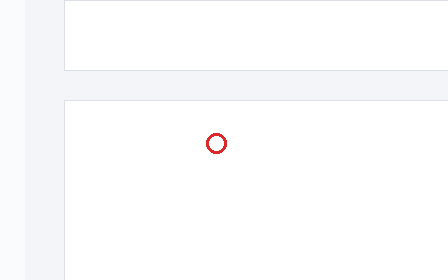
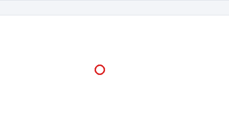

# Buy Microsoft 365 Licenses Through Thrive

stub reply that never matches any manifest, forcing template fallback

> [verify] (claim-001): Windows involved: SmartDeploy Console, Answer File Editor - SmartDeploy Console, Downloads - Google Chrome.
> [verify] (claim-002): Click the 'Save' Button in the 'SmartDeploy Console' window.
> [verify] (claim-003): Enter a value in the 'Computer name' Edit in the 'Answer File Editor - SmartDeploy Console' window (entered value in field (content not captured)).
> [verify] (claim-004): Click the position (900, 512) in the 'Downloads - Google Chrome' window.

## Step 1 — Click 'Save'

Click the 'Save' Button in the 'SmartDeploy Console' window.

## Step 2 — Enter value in 'Computer name'

Enter a value in the 'Computer name' Edit in the 'Answer File Editor - SmartDeploy Console' window (entered value in field (content not captured)).

**[REVIEW NEEDED — value not captured: add the value to enter]**

## Step 3

Click the position (900, 512) in the 'Downloads - Google Chrome' window.

**[REVIEW NEEDED — control not identified: check the screenshot]**

